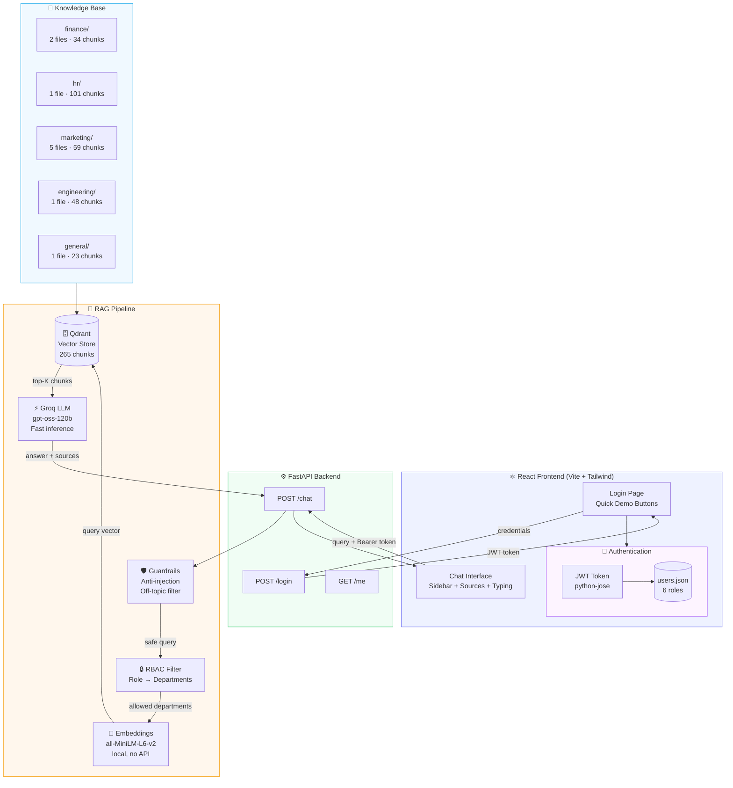

# FinSolve RBAC Chatbot — Architecture Diagram
# Mermaid diagram for presentation slides



## Roles & Access Matrix

| Document | employee | hr | marketing | finance | engineering | c_level |
|----------|:---:|:---:|:---:|:---:|:---:|:---:|
| employee_handbook.md | ✅ | ✅ | ✅ | ✅ | ✅ | ✅ |
| hr_data.csv | ❌ | ✅ | ❌ | ❌ | ❌ | ✅ |
| financial_*.md | ❌ | ❌ | ❌ | ✅ | ❌ | ✅ |
| marketing_*.md | ❌ | ❌ | ✅ | ❌ | ❌ | ✅ |
| engineering_*.md | ❌ | ❌ | ❌ | ❌ | ✅ | ✅ |

## Tech Stack Summary

| Layer | Technology | Why |
|-------|-----------|-----|
| LLM | Groq (gpt-oss-120b) | Free tier, fast |
| Embeddings | all-MiniLM-L6-v2 | Local, no cost |
| Vector Store | Qdrant (local) | No MSVC, RBAC filter |
| Backend | FastAPI + JWT | REST API, auto-docs |
| Frontend | React + Tailwind + Vite | Modern, fast |
| Guardrails | Custom (regex + keywords) | No extra cost |

## RAG Flow (step by step)

```
1. User logs in → JWT token (role embedded)
2. User sends query → POST /chat with Bearer token
3. FastAPI decodes JWT → extracts role
4. Guardrails check → block injections, off-topic
5. RBAC lookup → ["finance", "general"] for finance role
6. all-MiniLM-L6-v2 → embeds the query (384 dimensions)
7. Qdrant query → filter by department IN allowed_list
8. Top-5 chunks returned → with relevance scores
9. Prompt built → [SYSTEM] + [CONTEXT chunks] + [QUESTION]
10. Groq LLM → generates answer (temp=0.1, factual)
11. Response → answer text + source files + relevance %
```
